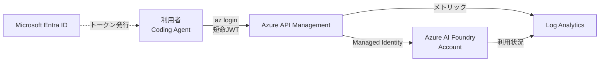

---

marp: true
theme: default
paginate: true
size: 16:9

<!--
タイトル：
信頼しているからこそ、情報を渡さない

副題：
生成AI基盤におけるシークレットレス設計と、その判断が実際に効いた話

発表時間：5分
想定：8枚
構成：
1. 導入・結論
2. 背景と課題
3. アーキテクチャ
4. 情報を持たない設計
5. 設計レビューでの葛藤
6. MZK9-GH0での再評価
7. 設計によって得られたもの
8. まとめ
-->

<!-- _class: lead -->

信頼しているからこそ、

情報を渡さない

生成AI基盤におけるシークレットレス設計と、
その判断が実際に効いた話

---

Azureで問題が起きたとき、何を確認する？

2026年11月、Azureの追跡番号 MZK9-GH0 を調査。

- APIMへの影響はあるのか？
- 認証情報の漏洩リスクは？
- 何か対応する必要があるのか？

結果：実際の対応作業は不要だった。

なぜ、そう判断できたのか。

<!--
導入では結論を先に提示する。

MZK9-GH0の具体的な通知内容や影響範囲は、実際の記録と照合して補完する。
今回の調査ではAPIMのSKU、Named ValuesのSecret設定、Service Health通知などを確認した。

重要なのは、Azure側の事象が発生したこと自体ではなく、
事象を受けて自分たちのシステムに何が残っているかを確認した点。

「何も問題がなかった」ではなく、「設計上、追加対応が必要な情報が存在しなかった」という説明にする。
-->
---

生成AI基盤を作るにあたって

Coding Agentを社内で安全に利用するための基盤を構築。

単にAIを使えるようにするだけでは不十分。

- 利用者の認証・アクセス制御
- 利用状況・コストの把握
- 機微情報の保護
- インシデント発生時の影響範囲の抑制

便利に使えることと、安全に使えることを両立させる。

<!--
製造業の社内向け基盤。
Coding Agentは利用者の指示を受けて自律的に処理するため、
単純なAPI利用以上に認証境界とバックエンドアクセスの分離が重要。

特にプロンプトや会話内容には機微情報が含まれる可能性がある。
通常の社内システム以上にデータの取り扱いを慎重に考えた。
-->---

構成：認証と実行主体を分離する

<!--
図の意図：
利用者からFoundryまでの認証経路を明確に見せる。
認証方式の違いを視覚的に強調する。
-->

- 利用者 → APIM：Entra IDによる認証
- APIM → Foundry：Managed Identityによる認証
- 利用者にAPIキーを配布しない

認証の責任とバックエンドへのアクセス権限を分離する。

<!--
構成の補足：

利用者はAzure CLIの az login によってEntra IDのトークンを取得。
APIMでJWTを検証し、利用者の識別・アクセス制御を実施する。

APIMからFoundryへのアクセスはManaged Identityを利用。
Foundry Account endpointを利用する構成であり、
Foundry Project endpointではない。

APIMは利用者の認証を担当し、FoundryへのアクセスはAPIM自身のMIで行う。
利用者にAzure APIキーを渡す必要がなく、APIMにもFoundryのAPIキーを保持しない。

厳密にはJWTのような短命トークンは存在するため、
完全なSecretlessではなく、長期的な共有シークレットを排除する設計。

監視系の接続先は実際の構成に合わせて表現を調整する。
-->
---

そもそも、情報を持たない

認証情報を持たない

- APIキー・クライアントシークレットを保持しない
- Named ValuesにはテナントIDのみ

会話内容を持たない

- リクエスト・レスポンスのBodyをログに送らない
- トークン数・セッション情報など必要なメトリックのみ収集

漏洩して困る情報を、最初から保持しない。

<!--
Named Valuesについて：

テナントIDは秘密情報ではない。
将来的な別Entraテナントへの展開を考慮して外部設定として管理。
テナントIDだけでは認証を突破できず、バックエンドへのアクセスも成立しない。

ログについて：

プロンプトや会話内容、個人情報をログ基盤に送ってからマスキングするのではなく、
そもそも収集対象に含めない。
ログ基盤の権限設定ミスや外部流出が発生しても、会話内容が残らないようにする。

必要な情報と保持する必要のない情報を分離する。
監視・コスト把握のための情報は取得するが、Bodyは取得しない。

補足：
セッション情報や利用者識別子の具体的な記録方式は、実装と照合する。
-->
---

ただし、設計は簡単には通らなかった

技術的には既知の設計パターン。

しかし、社内レビューでは必ずしも理解されなかった。

«Azureを信頼しているのだから、
ある程度の情報を預けてもよいのでは？»

- 情報を保持した方が障害調査に便利
- 運用上の利便性を優先したい
- 将来の拡張性や保守性も考慮したい

正しい設計を知っていることと、
実際に採用できることは別だった。

<!--
具体的な反対意見は、実際のレビュー記録と照合して補完する。

技術的な説明だけで完全な合意を得られたわけではない。
最終的には、設計者としての信頼貯金を使い、
ある程度の裁量を認めてもらって当初の方針を断行した。

ここは発表における重要な人間的・組織的な要素。
単なる技術紹介や成功談にしない。

目新しい技術を導入した話ではなく、
既知の設計原則を組織の実システムに適用する難しさを伝える。
-->
---

MZK9-GH0で、設計判断を振り返る

調査で確認したこと：

確認項目| 設計上の状態
APIキー・クライアントシークレット| 保持していない
Foundryへの認証| Managed Identity
Named Values| テナントIDのみ
ログのBody| 収集しない

結果として、追加対応は不要だった。

保持していない情報は、漏洩時にも対応対象にならない。

<!--
この結果をシークレットレス単独の成果として説明しない。

認証境界の分離、情報の非保持、ログのデータ最小化という複数の設計判断が組み合わさった結果。

ただし、すべてのリスクがなくなったわけではない。
・JWT有効期間中の悪用可能性
・APIM管理権限が侵害された場合
・設定変更やPolicy改ざん
・Managed Identityの権限悪用
などは別途考慮が必要。

今回の事象における対応不要の判断と、システム全体の安全性を混同しない。
具体的な影響評価の根拠はMZK9-GH0の通知内容と照合する。
-->
---

<!-- _class: lead -->
保護する情報を減らす

セキュリティ対策を増やすだけではなく、
そもそも守る必要のある情報を減らす。

- 攻撃対象領域を小さくする
- 漏洩時の影響範囲を小さくする
- インシデント時の調査・対応負荷を減らす

信頼しているからこそ、情報を渡さない。

<!--
締めのメッセージ。

Azureを信頼することと、Azureに必要以上の情報を渡すことは別問題。

クラウドサービスを信頼することと、クラウドに依存しすぎないことは両立できる。

セキュリティインシデントが起きたときに頑張って対応するのではなく、
そもそも対応が必要になる状況を作らない。

構築時には過剰と受け止められた設計が、
実際の事象を通じて運用負荷の低減という価値を持つことを実感した。

最後はタイトルをもう一度見せて終了。
-->